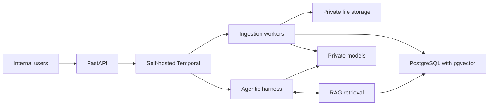

# Antara Sovereign AI

### Abstract

Antara Sovereign AI provides a private RAG pipeline and an agentic harness built on top of it. Multiple document workers extract text, split it into sections, generate embeddings, and build a searchable index. The agentic harness uses this retrieval layer and private language models to answer questions and carry out permitted internal tasks.

Everything runs on private compute within the organization’s network, including models, storage, Temporal, databases, logs, and backups. No documents, queries, or model outputs leave the network. Internet egress and external model APIs are disabled, and software and models are preloaded for offline operation.

### Business Value

- **Faster knowledge discovery:** Find information across internal documents without manually searching individual files.
- **Privacy and control:** Keep confidential content in an organization-controlled environment and limit access to authorized users.
- **Reliable processing:** Self-hosted Temporal coordinates both multiworker document ingestion and agent workflows, tracking progress and recovering from interruptions.
- **A practical starting point:** Use one application, ingestion and agent workers, and a shared Temporal service. Add worker capacity as usage grows.

### How We Protect Privacy and Control Data

- **Private compute:** We will run our models, ingestion workers, agentic harness, and self-hosted Temporal entirely within our private network.
- **No external sharing:** We will keep documents, queries, prompts, and outputs inside the network and block external model APIs and outbound internet access.
- **Access control:** We will authenticate users and enforce document permissions so users and agents can access only authorized information and internal tools.
- **Secure processing:** We will encrypt stored data and network traffic and use personal information only for approved purposes.
- **Data lifecycle control:** We will set retention periods and support correction and deletion of source documents and derived data, including appropriate handling of logs and backups.
- **Data protection rules:** We will support applicable privacy requirements through limited data use, access restrictions, retention controls, and correction and deletion workflows. We will keep internal records of access and deletion to demonstrate how we handle data.

### Proposed Architecture

Temporal coordinates ingestion and agent workflows. The harness uses RAG retrieval; private models support both ingestion and agent tasks. All logs and backups stay internal.

### Proposed Technology

- **Python and FastAPI:** Provide internal APIs for uploading documents, checking status, searching, deleting content, and starting agent runs.
- **Self-hosted Temporal:** Use a private Temporal service for two workflow types: document ingestion and agent execution. It tracks progress, retries failed activities, and resumes workflows after interruptions. Its database and UI are also hosted internally.
- **Multiworker ingestion:** Temporal coordinates extraction, chunking, embedding, and indexing across multiple Python workers. Workers perform the processing tasks and safely handle repeated attempts.
- **Agentic harness:** Build the agent execution layer on top of the RAG pipeline. Temporal coordinates retrieval, private model calls, and permitted internal tool actions. The harness defines agent behavior and enforces document and tool permissions.
- **PostgreSQL with pgvector:** Store document information, permissions, processing status, and searchable vectors. Make a new document version searchable only after processing completes.
- **Private file storage:** Keep original documents and extracted text in a self-hosted S3-compatible store.
- **Local models:** Run embedding and language models on private CPU or GPU servers for ingestion, retrieval, and agent reasoning.
- **Docker and internal access controls:** Package the services for private deployment. Use enterprise authentication, encryption, blocked internet egress, and internal monitoring.

### Reliability and Data Handling

Pass references to privately stored documents, prompts, and results through Temporal where possible, limiting sensitive content in workflow history. Apply access controls and retention rules to all ingestion and agent records. Tool actions must be safe to retry or protected against duplicate execution.
